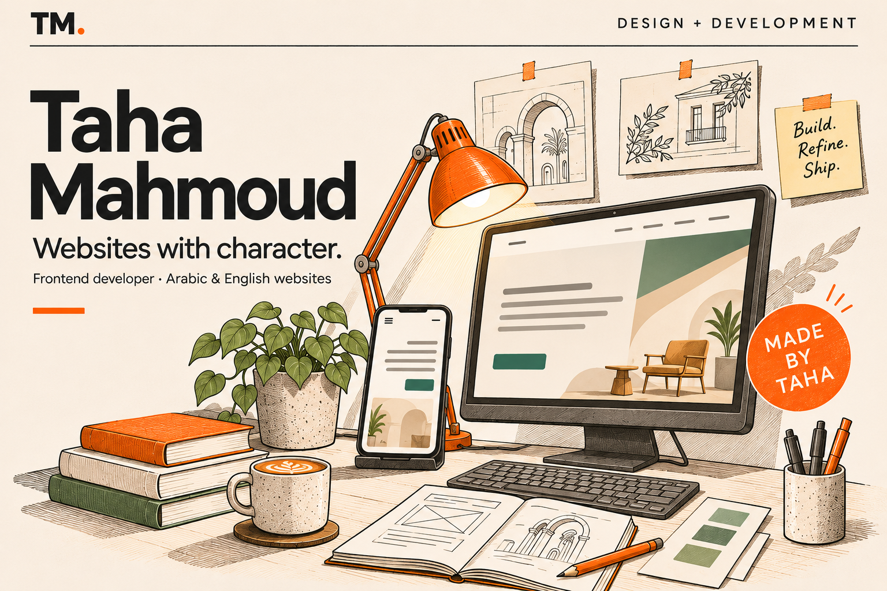
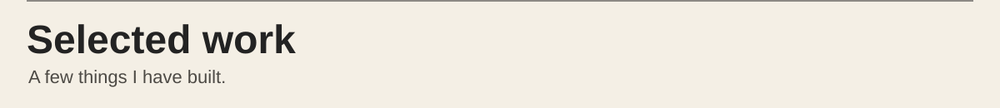
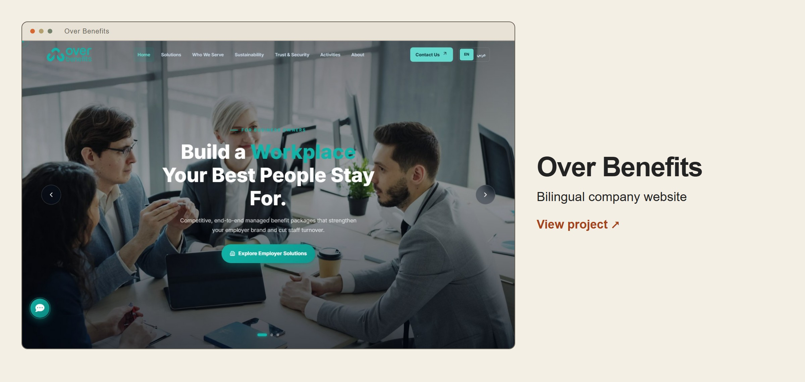
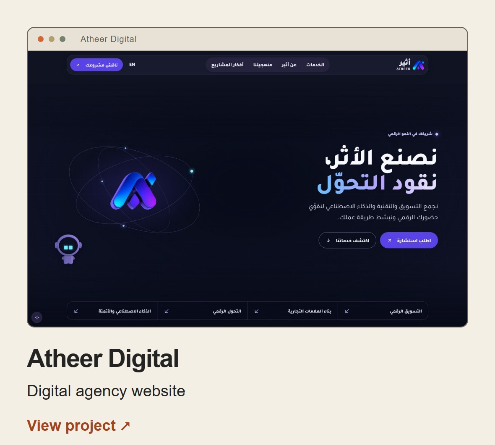
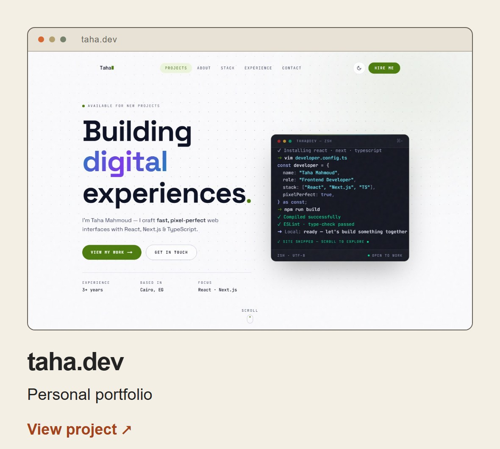
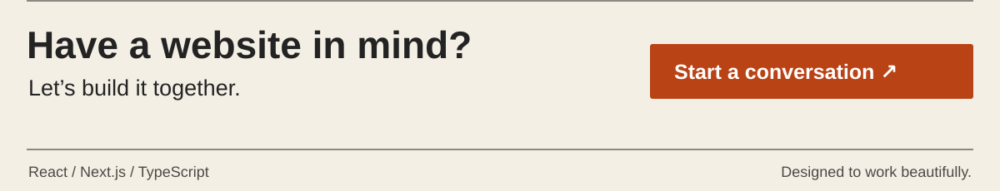

  

I design and develop responsive websites for businesses — company sites, landing pages, and interfaces in Arabic and English.

 

[Over Benefits](https://overbenefits.net/) · [Atheer Digital](https://atheer-digital.vercel.app/) · [taha.dev](https://taha-dev-eight.vercel.app/)

[Start a conversation](mailto:taha.mahmoud.abdellah@gmail.com) · [Visit my portfolio](https://taha-dev-eight.vercel.app/#contact)

Behind the work — toolkit &amp; GitHub activity

- **Interfaces:** React, Next.js, HTML, CSS
- **Languages:** TypeScript, JavaScript
- **Delivery:** Git, GitHub, Vercel

